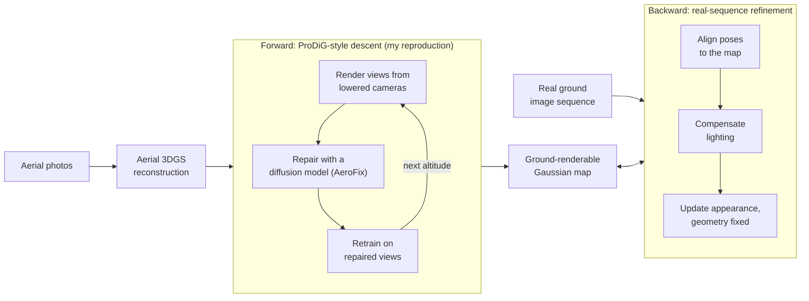

# ProDiG & AeroFix Reproduction

**Reimplementing an unreleased aerial-to-ground Gaussian Splatting method from its paper alone.** ProDiG turns an aerial 3D reconstruction into one that can be rendered from street level, using a diffusion model, AeroFix, to repair the views it synthesizes on the way down. When this project started, neither had public code or weights. This repository is my part of a five-person research project at CGV Lab, Handong Global University; the project is still in development and its paper is in preparation.


> Only code I wrote is here. The team's own method lives in the lab's private repository.

**Highlights**

- **Reimplemented ProDiG from the paper** on gsplat: progressive altitude descent, distance-adaptive Gaussians, a pluggable diffusion refiner, metric depth for synthesized views. About 2,300 lines of pipeline code plus evaluation scripts, with 40 unit tests.
- **Prepared AeroFix training data for 7 real aerial scenes (6,504 images)**, after tracing a failure on every scene to COLMAP exports that had no feature tracks.
- **Validated the team's trained AeroFix model**: perceptual quality improved (LPIPS 0.322 → 0.289) at a measured cost in pixel accuracy (PSNR −1.68 dB).
- **Found runs that exited with code 0 but produced garbage**, and made them fail loudly.

## The research project

Aerial photos cover a whole area but look poor from the ground, because the camera never saw facades, signs or the undersides of structures from that angle. The team is building **ReGround-GS**, which turns aerial imagery into Gaussian Splatting maps that render well from ground level, for use as simulation environments. It works in two directions:

- **Forward, aerial → ground.** Following ProDiG, start from an aerial reconstruction and descend in stages: 90%, 70%, 50%, 30% and 10% of the original altitude. At each stage, render views from lowered cameras, repair them with a diffusion model, and retrain on the repaired views.
- **Backward, ground → aerial.** Align real ground-level image sequences to that map and use them to refine it: refine their poses, compensate per-view lighting, and update only appearance on reliable static surfaces, keeping the geometry fixed and checking that the aerial views don't get worse.



My job was the foundation the forward half stands on: **reproducing ProDiG, and preparing data for and validating the AeroFix model it depends on.**

## The challenge

At the start of the project, ProDiG ([Mitra & Rawat](https://github.com/sirsh07/ProDiG)) and AeroFix had no public code or weights. We had the ProDiG paper and AeroFix's training method, so the team trained its own AeroFix model and I reimplemented ProDiG from the paper. The ProDiG code released since then still doesn't include the full progressive pipeline.

Where the paper is silent, such as the exact form of the distance-gating network, the training steps per stage, or the formula for filtering repaired views, I made explicit choices and documented them in the code.

## My contributions

| Area | What I did | Where |
|---|---|---|
| ProDiG reimplementation | The full progressive pipeline on gsplat, from the paper alone | [`prodig/`](prodig/), [`scripts/`](scripts/), [`tests/`](tests/) |
| AeroFix training data | Data prep for 7 GauUScene aerial scenes, including re-running SfM | [`lab_tools/aerofix_data_prep/`](lab_tools/aerofix_data_prep/) |
| AeroFix validation | Evaluation workflow and CLI for the team's checkpoint, 5 bugs found | [`lab_tools/aerofix_validation/`](lab_tools/aerofix_validation/) |
| ProDiG in the lab pipeline | A first-stage validator for the lab's own ProDiG baseline | [`lab_tools/prodig_forward_validation/`](lab_tools/prodig_forward_validation/) |
| Fixes in the lab's code | gsplat packed-mode background handling, gsplat/graphdeco rendering parity (view order, resolution, near plane), a bfloat16 crash and two observation-graph bugs, wrong-level metadata in the dataset validator | lab repository |

## ProDiG reimplementation

```
aerial photos + COLMAP poses   (or a pre-trained 3DGS PLY)
      │
      ├─ train the initial Gaussian model on the aerial photos
      ├─ for each altitude: 90% → 70% → 50% → 30% → 10%
      │     render novel views from lowered cameras          → noisy_views/
      │     repair each one with the diffusion refiner        → fixed_views/
      │     swap that camera's training image for the repair
      │     retrain
      └─ export the final Gaussians as a standard 3DGS PLY
```

| Piece | What it does | File |
|---|---|---|
| Distance-adaptive Gaussians | Two small MLPs shrink and fade each Gaussian according to its distance from the camera (ProDiG's scale and opacity gates). They start near identity, so training begins as plain 3DGS. | `modules.py`, `model.py` |
| Appearance embeddings | Per-image color correction for exposure and lighting differences between photos | `modules.py` |
| Pluggable refiner | Any `module:function` returning an object with `.fix()`. Bridges for AeroFix and GeoQuery, and an identity refiner for smoke tests | `aerofix.py`, `examples/` |
| Progressive dataset | Each camera contributes exactly one training image at a time: its latest accepted repair replaces the original | `dataset.py`, `trainer.py` |
| Metric depth for synthesized views | Synthesized views have no COLMAP tracks, so relative depth from Depth Anything 3 is calibrated against the Gaussian scene's own rendered depth. Checked on 40 real views against COLMAP-anchored depth: the calibration residual predicts true error with r = 0.91. | `depth_calib.py`, `scripts/validate_depth_calib.py` |
| Start from a PLY | Skip initial training by loading any trained 3DGS PLY (graphdeco, Scaffold-GS, …), with a startup check that the coordinate frame matches | `ply_input.py` |
| Evaluation | PSNR/SSIM against the real aerial photos at every stage, and stage-by-stage contact sheets comparing two runs | `scripts/` |

## AeroFix: training data and validation

**Training data.** AeroFix learns from pairs of a degraded render, the clean photo from the same pose, and a nearby reference photo. Generating them failed on all 7 GauUScene scenes: every candidate reference view was rejected. The scenes' COLMAP files had camera poses and points but no feature tracks, most likely because they were exported from photogrammetry software, and pairing requires at least 50 shared tracks. I re-ran Structure-from-Motion from the raw images, using sequential instead of exhaustive matching because the frames come from continuous drone flights. The first rebuilt scene registered 707 of 715 images with 447,276 tracked points.

**Validation** of the team's step-10,000 checkpoint on 10 MatrixCity test pairs:

| Metric | Input render | After AeroFix |
|---|---|---|
| LPIPS ↓ (perceptual) | 0.322 | **0.289** (8 of 10 pairs better) |
| PSNR ↑ | **27.45** | 25.77 |
| SSIM ↑ | **0.805** | 0.776 |

The model trades pixel accuracy for perceptual realism. It helped most on badly degraded renders and slightly hurt ones that were already sharp. Details, commands and the bug list: [`lab_tools/README.md`](lab_tools/README.md).

## Failures that didn't look like failures

The hardest problems in this project finished with exit code 0:

- **A missing dependency deleted the model.** Without scikit-learn, every Gaussian silently got the same initial size. gsplat's pruning step then culled almost all of them (**569,729 → 11 Gaussians**), renders went black, the refiner returned dark images, and those became training targets. The pipeline now refuses to start without scikit-learn.
- **Rejected views were used anyway.** A refiner rejects a view by returning quality 0, but the filter's default threshold was also 0, and `0.0 < 0.0` is false. Rejected views got through and replaced that camera's real photo. Quality 0 is now always rejected, with a test.
- **A wrong coordinate frame produced empty renders.** Loading a PLY in the wrong frame puts every Gaussian far from the cameras without any error. The pipeline now prints which frame the PLY appears to be in at startup.
- **Zero training pairs with no obvious cause.** The trackless COLMAP exports above.
- **A feature that looked unsupported.** AeroFix crashed on a `plucker_embed` argument, and a first look suggested the model never supported Plücker embeddings. A deeper check found the implementation and 32 trained tensors in the checkpoint; the argument was simply passed to the constructor instead of `forward()`.

The rule that came out of it, written into every runbook here: **don't trust a clean exit; look at the pixels.**

## Repository layout

```
├── prodig/          # the ProDiG reimplementation (self-contained, on gsplat)
├── examples/        # refiner bridges: AeroFix, GeoQuery (need the lab package), a template
├── scripts/         # depth estimation and calibration checks, PSNR evaluation, run comparison
├── tests/           # 40 unit tests
├── lab_tools/       # tools I wrote for the lab's codebase (need the lab package)
└── docs/            # usage guide (English and Korean)
```

## Running it

```bash
pip install -e ".[dev]"
python verify_install.py          # torch, gsplat, pycolmap, scikit-learn, ...
python -m pytest tests/ -q        # 40 tests, CPU is enough
```

A full run needs a CUDA GPU and a COLMAP scene (`images/` + an undistorted `sparse/0/`):

```bash
PYTHONPATH=. python -m prodig.train \
  --data data/scene --output outputs/run \
  --aerofix-factory examples.geoquery_bridge:create_geoquery \
  --reference-depth-dir data/scene/depths_metric \
  --initial-steps 7000 --stage-steps 7000 --min-aerofix-quality 0.01
```

The default `--aerofix-factory identity` runs the whole descent without a diffusion model, which checks the pipeline end to end. The AeroFix and GeoQuery bridges need model checkpoints and the lab's `anchor_prodig` package. Every flag, input and output is in [`docs/USAGE.md`](docs/USAGE.md) ([한국어](docs/USAGE_KO.md)).

## Status and limitations

- **Research code, in development.** The team's paper isn't out yet.
- **Not a verified match to the official ProDiG.** Where the paper is silent, the choices are mine (for example, distance normalized as `log(1 + d / scene_scale)`), so results can differ from the authors' system. This repository doesn't include end-to-end reproduction benchmarks yet.
- **The AeroFix result comes from 10 test pairs**, a first read rather than a verdict.
- **`lab_tools/` and the AeroFix/GeoQuery bridges need the lab's private package** and don't run on their own.

## Acknowledgements

Part of a five-person research project at the [Computer Graphics and Vision Lab (CGV Lab)](https://cgv-hgu.github.io), Handong Global University. Builds on ProDiG and AeroFix (S. Mitra and Y. S. Rawat, *ProDiG: Progressive Diffusion-Guided Gaussian Splatting for Aerial to Ground Reconstruction*), [gsplat](https://github.com/nerfstudio-project/gsplat), [COLMAP](https://colmap.github.io/), Depth Anything 3 and GeoQuery, with data from the GauUScene and MatrixCity datasets.

## License

[MIT](LICENSE). Model checkpoints and datasets are not included and remain under their own licenses.
